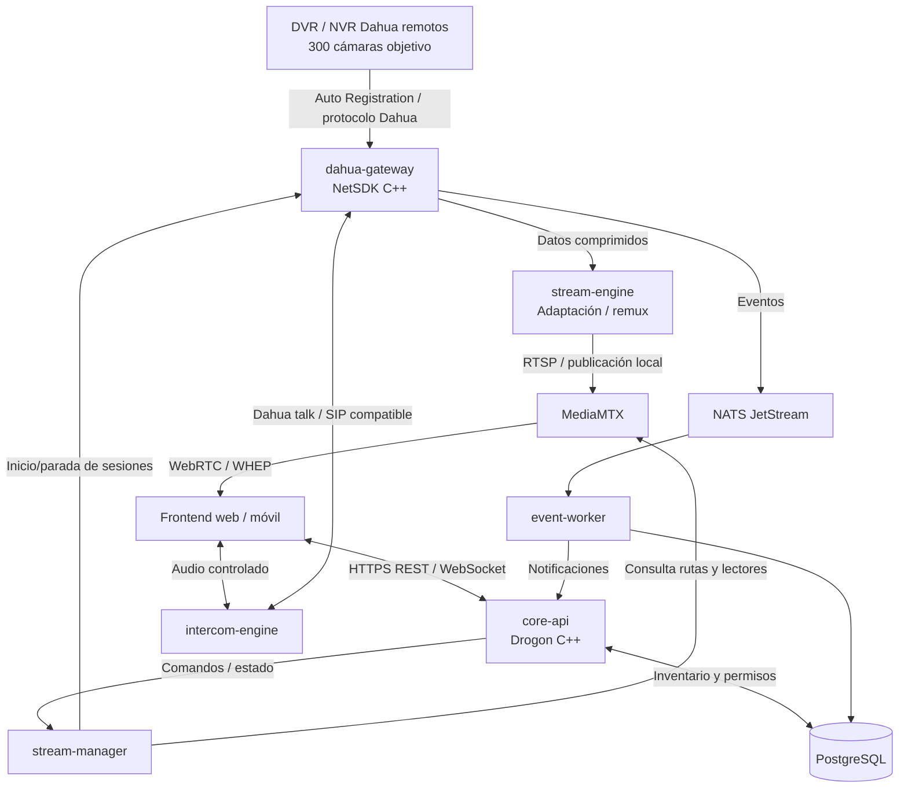
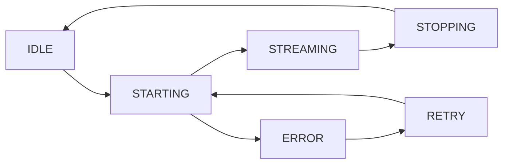

# Kuma Surveillance Platform

**Roadmap maestro de arquitectura e implementación — V1.0**  
**Stack principal:** C++20 · Drogon · Dahua NetSDK · MediaMTX · PostgreSQL · NATS JetStream  
**Estado:** planificación y primera integración  
**Alcance de esta versión:** administración centralizada de DVR/NVR Dahua, streaming bajo demanda, eventos y audio bidireccional en dispositivos compatibles. **Sin NVIDIA DeepStream en V1.**

> **Naturaleza del documento.** Este archivo es la especificación de trabajo y el plan de implementación. Las capacidades descritas como objetivos **no son funcionalidades ya construidas** ni benchmarks certificados. Especialmente, Auto Registration no garantiza por sí solo transporte de video ni audio en todos los modelos y versiones de firmware.

---

## 1. Visión y objetivos

Crear una plataforma propia, multiempresa y multisitio, con servicios nativos C++20 y un plano multimedia separado de la API.

### Objetivos funcionales

1. Registrar y administrar DVR/NVR Dahua desde diferentes conjuntos y organizaciones.
2. Integrar **Auto Registration** para que, cuando sea compatible, los dispositivos inicien conexión hacia el servidor central sin instalar PC/Raspberry Pi en la ubicación.
3. Detectar estado online/offline, identificar canales y consultar capacidades de cada dispositivo.
4. Abrir video **bajo demanda**, con un origen compartido entre múltiples espectadores de un mismo canal y perfil.
5. Publicar video hacia MediaMTX y reproducirlo por WebRTC/WHEP, con control de autorización por cámara.
6. Soportar eventos de movimiento, alarmas y notificaciones según las funciones del dispositivo.
7. Habilitar audio de escucha y conversación bidireccional en modelos compatibles; mantener integración especial para videoporteros VTO/SIP.
8. Aislar servicios y permitir futuras implementaciones distribuidas, observabilidad y actualizaciones seguras.
9. Preparar extensiones para otros fabricantes y, posteriormente, un motor de IA opcional.

### Capacidad objetivo inicial

- **Inventario:** 300 cámaras Dahua de aproximadamente 2 MP (normalmente 1920 × 1080) distribuidas entre varios DVR/NVR.
- **Visualización:** streaming bajo demanda; la cantidad de canales simultáneos debe determinarse mediante pruebas.
- **Video:** preferir passthrough/remultiplexación sin transcodificar; calidad principal 1080p cuando se solicite, perfil reducido para cuadrículas cuando el dispositivo lo permita.
- **Conectividad:** considerar rutas con alrededor de 200 ms de RTT y pérdida ocasional. No confundir ping con latencia extremo a extremo del video.
- **Sin hardware de retransmisión local:** la conectividad remota depende del modelo/firmware y de la ruta de red disponible.

---

## 2. Stack tecnológico

| Capa | Tecnología elegida | Responsabilidad |
| --- | --- | --- |
| Core y servicios | **C++20** | Lógica propia, gestión de recursos y procesos |
| HTTP / WebSocket | **Drogon** | API, administración y eventos para clientes |
| Fabricante Dahua | **NetSDK nativo** | Registro, autenticación, video, eventos, PTZ/audio compatibles |
| Publicación y distribución | **MediaMTX** | RTSP, WebRTC/WHEP y HLS cuando sea apropiado |
| Puente multimedia | **C++ y FFmpeg/GStreamer si hace falta** | Adaptación de buffers/códecs sin recodificación por defecto |
| Persistencia | **PostgreSQL** | Configuración, inventario, permisos, auditoría |
| Bus de eventos | **NATS JetStream** | Eventos entre servicios y procesamiento asíncrono |
| IPC posterior | **gRPC + Protobuf** | Contratos tipados entre procesos/nodos cuando aporte valor |
| Reverse proxy | **Caddy** | HTTPS, rutas públicas seguras |
| Borde | **Cloudflare** | DNS, WAF y servicios HTTP admitidos |
| Observabilidad | **Prometheus + Grafana** | Métricas, alertas y capacidad |
| Desarrollo | **Windows + CLion + MSVC x64 + CMake/vcpkg** | Desarrollo y pruebas locales |
| Producción | **Windows inicialmente o Linux con SDK equivalente** | Despliegue según soporte probado de cada binario |
| IA futura | **NVIDIA DeepStream** | **Excluido de V1**; interfaz futura desacoplada |

**Decisión de diseño:** Drogon es el **plano de control**, MediaMTX es el **plano de datos multimedia**. El video no atraviesa la API ni PostgreSQL.

---

## 3. Diagrama de arquitectura



**Nota:** las relaciones del diagrama son lógicas. El transporte efectivo de conversación WebRTC/SIP y el protocolo del SDK deben probarse; no están implementados por el hecho de dibujar la conexión.

### Separación de responsabilidades

**Plano de control:** autenticación, autorizaciones, dispositivos, sesiones, comandos, auditoría y estado.

**Plano multimedia:** recepción nativa, adaptación de contenedor/paquetes, publicación y reproducción.

**Plano de eventos:** alarmas, conectividad, notificaciones, métricas operativas.

---

## 4. Servicios V1

| Servicio | Proceso | Funciones principales | Restricción de diseño |
| --- | --- | --- | --- |
| `surveillance-core` / `core-api` | Drogon C++ | API, RBAC, organizaciones, cámaras, configuración, autorización | No recibe frames de video |
| `dahua-gateway` | C++ + NetSDK | Auto Registration, login, catálogo de canales, callbacks, eventos | Encapsula toda dependencia de NetSDK |
| `stream-engine` | C++ multimedia | Recepción de flujo comprimido, validación, remux hacia MediaMTX | Evitar decodificar/transcodificar salvo necesidad explícita |
| `stream-manager` | C++ | Inicio/parada de streams, deduplicación, TTL, reconexión y cuotas | Fuente única de verdad de sesiones activas |
| `intercom-engine` | C++ | Sesiones de conversación, audio de entrada/salida, posible adaptador SIP | Separado de video y de API |
| `event-worker` | C++ | Normalización, deduplicación y distribución de alarmas | Procesamiento idempotente |
| `mediamtx` | Servicio externo | Distribución RTSP/WebRTC/HLS, autenticación, métricas | No es un worker por GPU ni por cámara |
| `postgres` | Servicio externo | Persistencia | Sin almacenar frames normales |
| `nats` | Servicio externo | Mensajería durable | Mensajes pequeños/metadatos, no video |

**Implementación inicial:** uno o dos ejecutables propios (`surveillance-core` y `dahua-gateway`) más MediaMTX. Los demás procesos se extraen cuando existe una necesidad funcional real; no es necesario introducir gRPC/NATS desde el primer commit.

---

## 5. Roadmap por fases y criterios de salida

### Fase 00 — Fundación de desarrollo

**Objetivo:** compilar y ejecutar la estructura C++20 correctamente con MSVC x64.

**Tareas**
- [ ] Confirmar CLion con Toolchain Visual Studio/MSVC, no MinGW.
- [ ] Mantener CMake, vcpkg y dependencias en modo manifest.
- [ ] Mantener independientes los targets `surveillance-core` y `dahua-gateway`; cada uno tiene su propio `main.cpp`.
- [ ] Compilar Drogon y probar `GET /api/v1/health`.
- [ ] Integrar biblioteca Dahua Win64 en `third_party/dahua/` sin publicarla en Git.
- [ ] Documentar compilación Debug/Release y crear pruebas automatizadas básicas.

**Criterio de aceptación:** ambos ejecutables compilan de forma independiente; la API responde y el proceso Dahua inicializa y finaliza el SDK sin errores.

**Estado al redactar:** estructura y CMake preparados; la ejecución real de ambos programas todavía requiere confirmación con logs.

### Fase 01 — Dahua Gateway y Auto Registration

**Objetivo:** recibir el registro de un DVR real, autenticarlo y mantener una sesión de dispositivo.

**Tareas**
- [ ] Implementar RAII para `CLIENT_Init`/`CLIENT_Cleanup`.
- [ ] Registrar callbacks de desconexión y reconexión sin operaciones bloqueantes.
- [ ] Iniciar `CLIENT_ListenServer` en puerto configurable y comprobar el retorno.
- [ ] Identificar correctamente tipos de evento y el identificador de registro del DVR.
- [ ] Guardar en memoria una estructura `DeviceRegistration` con identidad y hora de llegada.
- [ ] Implementar `CLIENT_LoginWithHighLevelSecurity` usando **SERVER_CONN** cuando corresponda; conservar la vida útil del buffer de identificación durante la llamada.
- [ ] Implementar retroceso exponencial y límites para evitar bloqueos de cuenta por intentos fallidos.
- [ ] Probar salida/reconexión, múltiples dispositivos, claves incorrectas, corte de red y cierre limpio.

**Criterio de aceptación:** un DVR real se registra, autentica, reporta estado y puede reconectarse tras una interrupción.

**Riesgo bloqueante:** que Auto Registration funcione **no garantiza** que el video se pueda transportar por el mismo mecanismo en todos los equipos. Esta compatibilidad deberá verificarse en Fase 03.

### Fase 02 — Inventario y capacidades

**Objetivo:** convertir registros nativos en dispositivos administrables.

**Tareas**
- [ ] Crear `DeviceSessionManager` con mapa de identidad estable → sesión.
- [ ] Consultar cantidad real de canales y tipo de grabador.
- [ ] Identificar canales habilitados, audio disponible, perfiles de video y PTZ según soporte.
- [ ] Asociar cada dispositivo a una organización y ubicación.
- [ ] Manejar cambios de canales tras reinicio o reconfiguración del DVR.
- [ ] Exponer en API el catálogo sin filtrar credenciales ni handles.

**Criterio de aceptación:** la API lista DVR y canales reales, y refleja los cambios de conectividad.

### Fase 03 — Primer video Dahua → MediaMTX

**Objetivo:** reproducir el video de un canal real, remoto y autorizado.

**Tareas**
- [ ] Abrir canal mediante `CLIENT_RealPlayEx` o interfaz equivalente de la versión instalada.
- [ ] Registrar callback compatible con el formato realmente entregado.
- [ ] Inspeccionar encabezados, keyframes, códec y contenedor; identificar si llegan paquetes DHAV o flujo elementary H.264/H.265.
- [ ] Construir puente a MediaMTX, preferentemente **sin recodificar**.
- [ ] Verificar publicación RTSP local y reproducción con WebRTC/WHEP.
- [ ] Medir retardo de apertura, retardo de video, pérdida y uso de CPU.
- [ ] Probar exactamente el mismo dispositivo vía Auto Registration, sin acceso directo al puerto RTSP desde el servidor.
- [ ] Documentar alternativas si un modelo obliga a conectividad por VPN o acceso IP en lugar de utilizar la sesión de registro.

**Criterio de aceptación:** una cámara real se abre desde el navegador y se cierra sin fugas de sesiones ni procesos.

**Puerta de decisión obligatoria:** no ampliar el proyecto a 300 cámaras hasta demostrar que el transporte funciona con al menos un modelo/firmware representativo de los DVR existentes.

### Fase 04 — Stream Manager bajo demanda

**Objetivo:** administrar consumidores y orígenes sin conexiones duplicadas.

**Tareas**
- [ ] Definir estado `IDLE → STARTING → STREAMING → STOPPING`, con `ERROR/RETRY`.
- [ ] Identificar origen por `(device_id, channel, profile)`.
- [ ] Mantener referencias/leases de consumidores y de servicios internos.
- [ ] Arrancar una sola sesión por perfil y reutilizarla para múltiples espectadores.
- [ ] Aplicar periodo de gracia antes de detener el último origen.
- [ ] Implementar timeout de apertura, cancelación, límite de memoria y backpressure.
- [ ] Manejar fallos del grabador, reinicios de MediaMTX y recuperación de streams.
- [ ] Usar substream para cuadrícula y main stream para pantalla completa si están disponibles.

**Criterio de aceptación:** dos espectadores del mismo canal comparten la sesión de origen; la sesión se libera después de que ambos se retiran.

### Fase 05 — PostgreSQL y multiempresa

**Objetivo:** persistir configuración, dispositivos, usuarios y permisos.

**Tareas**
- [ ] Definir migraciones versionadas y esquema inicial.
- [ ] Implementar organizaciones (`tenants`) y ubicaciones (`sites`).
- [ ] Modelar dispositivos, canales, perfiles, autorizaciones y credenciales cifradas.
- [ ] Aplicar filtros de tenant en **todas** las consultas de recursos.
- [ ] Crear roles, permisos y auditoría de comandos sensibles.
- [ ] Separar identidad de dispositivo persistida del estado de conexión en memoria.
- [ ] Preparar backups, retención y migraciones reversibles donde sea posible.

**Criterio de aceptación:** usuarios de una organización no pueden acceder a dispositivos o streams de otra, incluso cambiando identificadores en las rutas.

### Fase 06 — Eventos, alarmas y notificaciones

**Objetivo:** distribuir información operacional y alarmas con fiabilidad.

**Tareas**
- [ ] Suscribirse a eventos soportados por NetSDK.
- [ ] Normalizar `device.online`, `device.offline`, `camera.alarm`, `camera.motion`, etc.
- [ ] Publicar eventos en NATS JetStream cuando exista necesidad distribuida.
- [ ] Consumir eventos de manera idempotente y con confirmación de recepción.
- [ ] Persistir historial de eventos y entregar WebSocket/SSE a usuarios autorizados.
- [ ] Aplicar deduplicación, ventanas de enfriamiento y reglas antirruido.

**Criterio de aceptación:** los eventos se almacenan y se notifican sin duplicaciones visibles tras reintentos.

### Fase 07 — Audio bidireccional e intercomunicación

**Objetivo:** escuchar y hablar desde web/móvil con dispositivos compatibles.

**Tareas**
- [ ] Distinguir audio entrante del stream de video de las sesiones de conversación.
- [ ] Implementar negociación/consulta de códecs por modelo: G.711, PCM u otros admitidos.
- [ ] Crear flujo de audio navegador (WebRTC) → motor de audio → SDK → dispositivo.
- [ ] Crear flujo inverso dispositivo → SDK → motor de audio → navegador.
- [ ] Probar `CLIENT_StartTalkEx`, `CLIENT_TalkSendData`, parada de conversación y selección de canal.
- [ ] Determinar cuándo un canal IP necesita modo de reenvío (`talk transfer`).
- [ ] Manejar ocupación exclusiva, interrupciones, timeouts y permisos de micrófono.
- [ ] Integrar VTO/SIP como adaptador **separado** cuando el equipo lo requiera.
- [ ] Auditar cualquier orden de apertura de puerta y autorizarla de manera independiente.

**Criterio de aceptación:** audio funcional en ambos sentidos con una cámara modelo objetivo, bajo pérdidas y reconexiones realistas.

**Aclaración:** los flujos de conversación no se resuelven automáticamente con MediaMTX; requieren un puente y señalización compatibles con cada equipo.

### Fase 08 — Seguridad, dominios y acceso externo

**Objetivo:** proteger cámaras, dispositivos y superficie pública.

**Tareas**
- [ ] Exponer HTTPS mediante Caddy/Cloudflare para APIs y señalización.
- [ ] Usar autenticación por usuario, organización y permiso concreto de cámara.
- [ ] Emitir credenciales temporales de reproducción y autorizar en MediaMTX.
- [ ] Impedir reproducción anónima basada solo en el ID o URL del canal.
- [ ] Mantener RTSP de publicación, Control API, PostgreSQL y NATS en interfaces privadas.
- [ ] Proteger puertos NetSDK y transporte WebRTC con firewall y controles propios.
- [ ] Diferenciar **Cloudflare HTTP proxy** del transporte WebRTC UDP: no se protege automáticamente el segundo con WAF.
- [ ] Asegurar RDP/SSH de administración por VPN o acceso restringido y MFA.
- [ ] Cifrar credenciales de dispositivos en reposo, rotar secretos y nunca almacenarlos en el repositorio.
- [ ] Aplicar rate limiting, registros de auditoría y límites de sesión.

**Criterio de aceptación:** una persona no autorizada no puede obtener video ni emitir comandos aunque conozca la URL del stream o la IP del servidor.

### Fase 09 — Observabilidad y operación 24/7

**Objetivo:** anticipar errores y recuperar automáticamente sesiones.

**Tareas**
- [ ] Logs estructurados con `trace_id`, `device_id`, `camera_id`, sin credenciales.
- [ ] Métricas: DVR registrados, conexiones activas, canales en streaming, lectores, red, CPU, RAM, latencia de apertura y errores NetSDK.
- [ ] Métricas de video: bitrate, interrupciones, keyframes perdidos, tiempo sin frames y reconexiones.
- [ ] Servicios Windows o systemd para reinicio automático y arranque tras reinicio del sistema.
- [ ] Health checks y readiness específicos por servicio.
- [ ] Alertas para caída de gateway, aumento de errores, saturación o pérdida de conectividad.
- [ ] Backups probados, retención de logs y procedimientos de recuperación.

**Criterio de aceptación:** un reinicio de MediaMTX o un corte de un DVR no requiere intervención manual para restaurar las sesiones que deban seguir activas.

### Fase 10 — Rendimiento y escalado a 300 cámaras

**Objetivo:** validar capacidad de inventario y concurrencia sin inventar benchmarks.

**Pruebas progresivas**

| Escalón | Qué medimos |
| --- | --- |
| 1 DVR / 1 cámara | Registro, reproducción, formatos, audio y seguridad |
| 1 DVR / 8 cámaras | Sesiones simultáneas, pérdida y calidad 720p/1080p |
| 25 cámaras abiertas | CPU/ram/red y tasa de errores |
| 50 cámaras abiertas | Efecto de buffers y procesos puente |
| 100 cámaras abiertas | Concurrencia, tiempo de apertura y espectadores |
| 150–200 abiertas | Solo si las métricas anteriores mantienen margen |
| 300 cámaras inventariadas | Registro masivo, estabilidad, reconexión y consultas API |

**Condiciones de prueba**
- [ ] Diferenciar 300 **cámaras registradas** de 300 **streams abiertos**.
- [ ] Medir entrada desde DVR y salida a espectadores por separado.
- [ ] Probar 1, 2 y 5 espectadores por cámara, para cuantificar salida de red.
- [ ] Inyectar pérdida de paquetes, jitter, latencia y cortes para medir recuperación.
- [ ] Realizar prueba prolongada (por ejemplo, 72 horas) sin fugas ni degradación acumulativa.
- [ ] Validar impacto de audio de intercomunicadores en paralelo.
- [ ] Establecer límites máximos de sesiones y mecanismos de rechazo controlado.

**Estimación de tráfico, no benchmark:** 8 canales a 2 Mbps ≈ 16 Mbps de entrada; 100 canales ≈ 200 Mbps; 300 canales ≈ 600 Mbps, más sobrecarga y salida hacia usuarios. La velocidad real de subida en cada conjunto puede ser el límite antes que la CPU central.

### Fase 11 — Producción, documentación y soporte

**Objetivo:** despliegue repetible, operable y seguro.

**Tareas**
- [ ] Versionado semántico, notas de cambios y artefactos de Release.
- [ ] CI para C++20: build, tests, análisis estático y chequeo de dependencias.
- [ ] Empaquetado de servicios y configuración externa con secretos fuera del código.
- [ ] Manual de instalación Windows/Linux según plataforma certificada.
- [ ] Procedimientos de rollback, recuperación de base de datos y restauración de servicios.
- [ ] Plan de respaldo y pruebas periódicas.
- [ ] Matriz soportada de modelos Dahua y firmwares probados.
- [ ] Dashboard de salud operacional y manual de respuesta a incidentes.

**Criterio de aceptación:** instalación desde cero reproducible y restauración probada tras una falla controlada.

---

## 6. Modelo de datos inicial

### Entidades

| Tabla | Campos clave propuestos | Observaciones |
| --- | --- | --- |
| `tenants` | `id`, `name`, `status` | Organización/cliente |
| `sites` | `id`, `tenant_id`, `name`, `timezone` | Conjunto o ubicación |
| `users` | `id`, `tenant_id`, `email`, `status` | Identidad y acceso |
| `roles`, `permissions`, `user_roles` | `tenant_id`, relaciones | RBAC con aislamiento |
| `devices` | `id`, `site_id`, `vendor`, `model`, `serial`, `firmware` | DVR/NVR |
| `device_credentials` | `device_id`, `encrypted_secret`, `key_version` | Separado y cifrado |
| `device_connections` | `device_id`, `gateway_node_id`, `state`, `last_seen` | Estado actual e historial |
| `cameras` | `id`, `device_id`, `channel_index`, `name`, `enabled` | `channel_index` interno puede iniciar en 0 |
| `camera_profiles` | `camera_id`, `profile`, `codec`, `width`, `height`, `fps` | Main/sub según soporte |
| `media_sessions` | `id`, `camera_id`, `profile`, `state`, `owner_node_id` | Origen en streaming |
| `stream_leases` | `session_id`, `consumer_id`, `expires_at` | Lectores autorizados |
| `intercom_sessions` | `id`, `device_id`, `camera_id`, `user_id`, `state` | Hablar/escuchar |
| `alarms` | `id`, `device_id`, `camera_id`, `type`, `occurred_at` | Eventos normalizados |
| `audit_logs` | `id`, `actor_id`, `action`, `resource`, `created_at` | Trazabilidad |
| `nodes` | `id`, `type`, `health`, `last_heartbeat` | Escalado futuro |

### Reglas de datos

- IDs públicos opacos (por ejemplo UUID/ULID); no exponer los handles numéricos del SDK.
- Toda consulta de cámara/dispositivo requiere `tenant_id` derivado de la sesión autenticada.
- El estado del SDK y los handles se mantienen **en memoria** del gateway; en la base de datos queda estado informativo, nunca punteros nativos.
- La credencial del DVR no se devuelve jamás por API ni se incluye en logs.
- Retención de alarmas y grabaciones definida por la organización y por política de privacidad.

---

## 7. API pública propuesta (V1)

Los siguientes endpoints son **contratos objetivo**, no rutas ya implementadas.

| Método | Ruta | Propósito |
| --- | --- | --- |
| `GET` | `/api/v1/health` | Salud básica del core |
| `GET` | `/api/v1/system` | Versiones y estado de servicios |
| `GET` | `/api/v1/devices` | Lista filtrada por permisos |
| `POST` | `/api/v1/devices` | Vincular/provisionar dispositivo |
| `GET` | `/api/v1/devices/{deviceId}` | Detalles y conectividad |
| `GET` | `/api/v1/devices/{deviceId}/cameras` | Canales y capacidades |
| `GET` | `/api/v1/cameras/{cameraId}` | Configuración de cámara |
| `POST` | `/api/v1/cameras/{cameraId}/sessions` | Iniciar/reutilizar stream |
| `DELETE` | `/api/v1/streams/{sessionId}` | Liberar lease/sesión del usuario |
| `POST` | `/api/v1/cameras/{cameraId}/talk` | Iniciar conversación autorizada |
| `DELETE` | `/api/v1/intercom/{sessionId}` | Finalizar conversación |
| `GET` | `/api/v1/events` | Consultar alarmas |
| `GET` | `/api/v1/nodes` | Diagnóstico administrativo |
| `GET` | `/api/v1/ws/events` | Canal de eventos en vivo (o ruta WebSocket equivalente) |

### Ejemplo conceptual de sesión de video

`POST /api/v1/cameras/01J.../sessions`

```json
{
  "profile": "sub",
  "transport": "webrtc"
}
```

Respuesta ilustrativa:

```json
{
  "session_id": "opaque-session-id",
  "status": "starting",
  "playback": {
    "type": "whep",
    "url": "https://video.miapp.com/live/camera-opaque/sub/whep"
  },
  "authorization": "short-lived-token"
}
```

- Los permisos deben validarse en la API y **también** en MediaMTX.
- El cierre de la sesión del usuario no detiene la fuente si hay otros espectadores o procesos autorizados.
- Un token corto para iniciar reproducción no equivale automáticamente a revocación de una conexión WebRTC ya establecida; se necesita política explícita de duración y corte de sesiones.

---

## 8. Contratos internos y eventos

### Mensajes/eventos sugeridos

```text
device.registered
device.authenticated
device.disconnected
device.reconnected
camera.stream.requested
camera.stream.started
camera.stream.failed
camera.stream.stopped
camera.motion
camera.alarm
intercom.started
intercom.ended
node.health.changed
```

Todos los eventos requieren `event_id`, `occurred_at`, `source_node`, y cuando corresponda `tenant_id`, `device_id`, `camera_id`, `correlation_id`.

### Semántica operativa

- Consumidores idempotentes ante entregas duplicadas.
- Reintentos con demora variable (backoff), sin bucles de conexión agresivos.
- TTL y límites para colas y buffers; nunca crecimiento ilimitado.
- Los callbacks NetSDK no deben bloquearse por SQL, red externa o tareas pesadas.
- Un único proceso/owner lógico debe gobernar cada sesión de dispositivo para evitar logins o conexiones conflictivas.

---

## 9. Arquitectura del repositorio

```text
kuma-surveillance-platform/
├── CMakeLists.txt
├── vcpkg.json
├── apps/
│   ├── core-api/
│   │   ├── include/api/
│   │   └── src/
│   ├── dahua-gateway/
│   │   ├── include/
│   │   └── src/
│   ├── stream-engine/
│   ├── stream-manager/
│   ├── intercom-engine/
│   └── event-worker/
├── libs/
│   ├── dahua-adapter/
│   ├── domain/
│   ├── media-adapter/
│   ├── persistence/
│   ├── auth/
│   └── telemetry/
├── proto/
├── database/
│   └── migrations/
├── infra/
│   ├── mediamtx/
│   ├── postgres/
│   ├── nats/
│   ├── caddy/
│   └── monitoring/
├── third_party/
│   └── dahua/      # No versionar SDK/binarios propietarios
├── tests/
│   ├── unit/
│   ├── integration/
│   ├── device-lab/
│   └── load/
├── docs/
└── .gitignore
```

### Estándares de ingeniería

- CMake por targets, bibliotecas propias y dependencias mínimas.
- RAII para handles de NetSDK y sockets; prohibir doble liberación.
- Análisis estático (Clang-Tidy) y pruebas de sanitizers en compilaciones compatibles.
- API y adaptadores mediante interfaces; lógica de dominio independiente de NetSDK.
- Pruebas unitarias sin necesidad de conectar un DVR mediante mocks del adaptador.
- Logs estructurados, configuración versionada y secretos externos.

---

## 10. Streaming y perfiles

### Estados de sesión



### Perfiles orientativos

| Uso | Resolución | FPS | Bitrate aproximado | Condición |
| --- | --- | --- | --- | --- |
| Cuadrícula/baja red | 640×360, si existe | 10–15 | 0,5–1 Mbps | Substream configurado en DVR |
| Visualización HD | 1280×720, si existe | 15 | 1,5–2,5 Mbps | Stream disponible o perfil específico |
| Pantalla completa | 1920×1080 (2 MP) | 15 | 2–4 Mbps | Main stream bajo demanda |

Estos rangos son puntos de partida, no configuraciones universales. La calidad depende de escena, GOP, códec y capacidad de subida del sitio.

### Política de latencia

- Preferir H.264 compatible con navegador y evitar transcodificación.
- Priorizar WebRTC para vivo; HLS solo cuando su mayor buffering resulte aceptable.
- Medir separately RTT de red, tiempo de apertura y retraso real de video extremo a extremo.
- Configurar buffers acotados; más buffering puede evitar interrupciones pero aumenta latencia.
- Si hay pérdidas, comprobar origen, rutas y subida del conjunto antes de modificar memoria/CPU del servidor.

---

## 11. Seguridad y despliegue

### Windows / CLion (desarrollo)

- Toolchain Visual Studio/MSVC x64, no mezclar con paquetes `x64-windows` usando MinGW.
- Dos targets: `surveillance-core.exe` y `dahua-gateway.exe`.
- `dhnetsdk.h`, `.lib` y `.dll` de una misma versión oficial.
- Puerto de registro accesible únicamente desde red de pruebas o rangos autorizados.
- MediaMTX y APIs administrativas vinculadas a `127.0.0.1` mientras no exista autenticación.

### Producción

- Ejecutar procesos bajo usuarios de servicio con permisos mínimos.
- Segmentar tráfico administrativo, registro Dahua y WebRTC.
- Restringir puertos de MediaMTX y bases de datos; no exponer RTSP administrativo públicamente.
- TLS para dominios y rutas HTTP; WebRTC requiere configurar señalización y transporte por separado.
- Windows y Linux tienen **paquetes distintos del NetSDK**; se recompila y valida compatibilidad de cada plataforma.
- Cloudflare WAF no protege automáticamente Auto Registration TCP ni media WebRTC UDP directo.

---

## 12. Riesgos y decisiones abiertas

| Riesgo | Impacto | Mitigación / decisión |
| --- | --- | --- |
| Firmware Dahua no permite video sobre Auto Registration | Bloquea streaming sin conexión directa | Probar un DVR representativo antes de ampliar |
| SDK nativo o callback se comporta distinto por modelo | Errores de sesión | Matriz de compatibilidad por modelo/firmware |
| IP/canal sin audio bidireccional o reenvío no soportado | No funciona intercom | Probar cámara directa vs DVR, canal y códec |
| 200 ms y pérdida intermitente hacia servidor externo | Congelamientos/retraso | Medir subida y pérdida extremo a extremo, ajustar bitrate/GOP |
| 1 Gbps compartido con muchos espectadores | Saturación | Monitoreo ingreso/salida, cuotas, substream |
| Interrupción de un único servidor | Caída total de visualización central | Backups, reinicio automático, nodos redundantes futuros |
| Credenciales expuestas en código/archivos | Acceso no autorizado a cámaras | Rotación, cifrado y secrets manager |
| Mezcla de SDK Win64 y Linux | Fallo de ejecución/enlace | Compilaciones nativas por sistema operativo |
| Autorización limitada solo a URLs aleatorias | Filtración de cámaras | Token corto y autenticación MediaMTX por ruta |
| Licencias o redistribución del SDK | Riesgo contractual | Revisar condiciones de Dahua antes de distribuir el producto |

---

## 13. Criterios generales de aceptación de V1

Se considera V1 lista para piloto controlado cuando:

- [ ] Drogon y Dahua Gateway compilan y se ejecutan sin interferirse.
- [ ] Un dispositivo se registra y autentica mediante Auto Registration.
- [ ] Se recupera su catálogo de cámaras, con persistencia y permisos.
- [ ] Una cámara real se publica en MediaMTX sin recodificación cuando es viable.
- [ ] Se reproduce mediante navegador/WebRTC con autorización.
- [ ] Dos espectadores pueden compartir un solo stream origen.
- [ ] El stream se detiene si no quedan consumidores autorizados.
- [ ] Se recupera la visualización después de cortar/restaurar red.
- [ ] Eventos y cambios de conectividad se pueden consultar desde API.
- [ ] Se registra auditoría de acceso y operaciones sensibles.
- [ ] Audio bidireccional opera en al menos un modelo compatible certificado.
- [ ] Las métricas muestran uso de red, sesiones, errores y tiempos de apertura.
- [ ] Existe instalación documentada y backup/restore comprobado.

**Certificación de 300 cámaras:** hito separado; requiere las pruebas de concurrencia e inventario de Fase 10, no se deduce de la finalización de las funciones V1.

---

## 14. Orden práctico de los próximos trabajos

**Siguiente sesión de implementación (prioridad inmediata):**

1. Confirmar compilación real de `dahua-gateway` con el NetSDK Win64 3.061.
2. Ejecutar el proceso y verificar escucha de TCP 9500.
3. Probar un DVR en red de laboratorio y registrar evento de Auto Registration.
4. Autenticar el dispositivo mediante el modo soportado por NetSDK, sin guardar contraseñas en fuente.
5. Consultar canales y añadir estructuras `DeviceSessionManager` y `CameraInfo`.
6. Conectar el primer stream a MediaMTX y comprobar reproducción web.
7. Solo entonces incorporar PostgreSQL, permisos y sesiones bajo demanda.

### Funcionalidad deliberadamente fuera de V1

- NVIDIA DeepStream, TensorRT y scheduling de GPUs.
- Reconocimiento facial y ALPR masivo.
- Grabación continua centralizada de las 300 cámaras.
- Transcodificación masiva de H.265 a H.264.
- Clúster automático multirregión y balanceo avanzado entre nodos.

Se reservan puntos de extensión, pero no se implementan hasta contar con una base de video y sesiones estable.

---

## 15. Resultado final esperado

Una solución de videovigilancia nativa, modular y multiempresa que utilice **C++20 + Drogon + Dahua NetSDK + MediaMTX**, permita registrar dispositivos Dahua remotos, administrar cámaras y permisos, abrir video bajo demanda y ofrecer eventos/audio en dispositivos compatibles. El sistema estará diseñado para **300 cámaras inventariadas**, y se expandirá según benchmarks de concurrencia reales, sin añadir DeepStream a esta primera versión.
